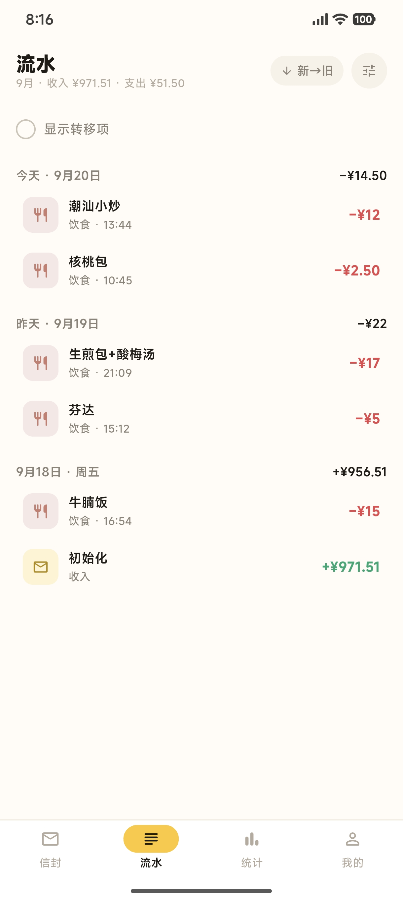
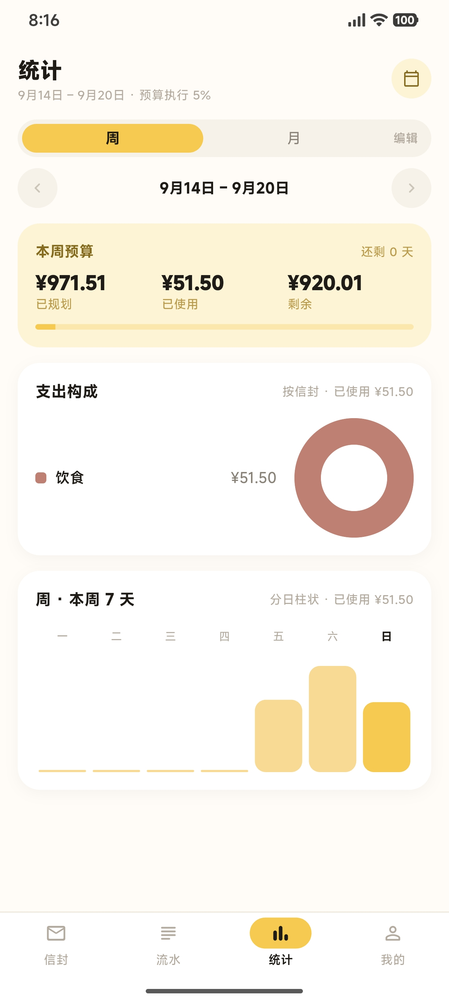
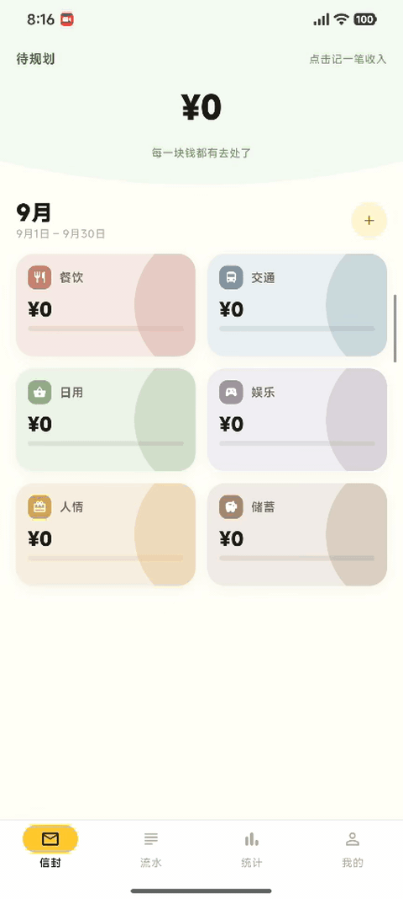
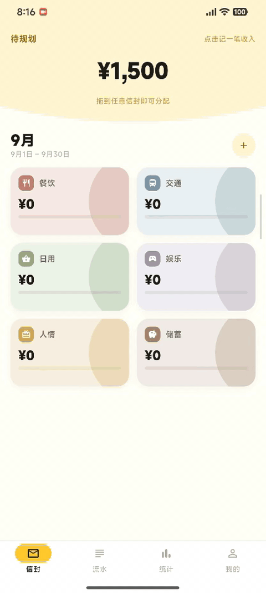
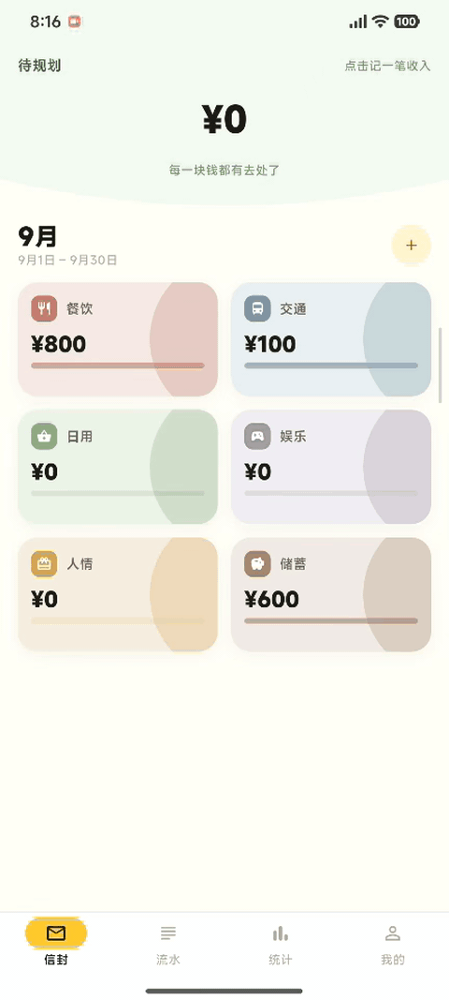
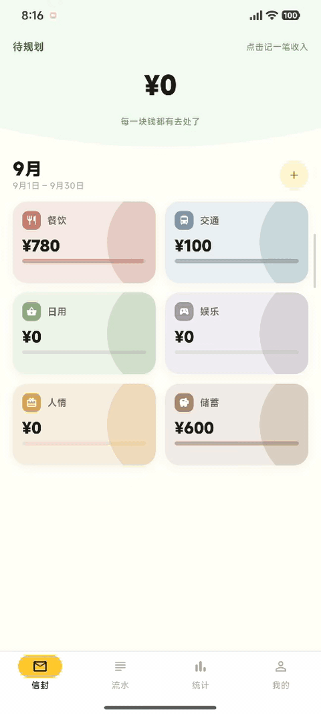
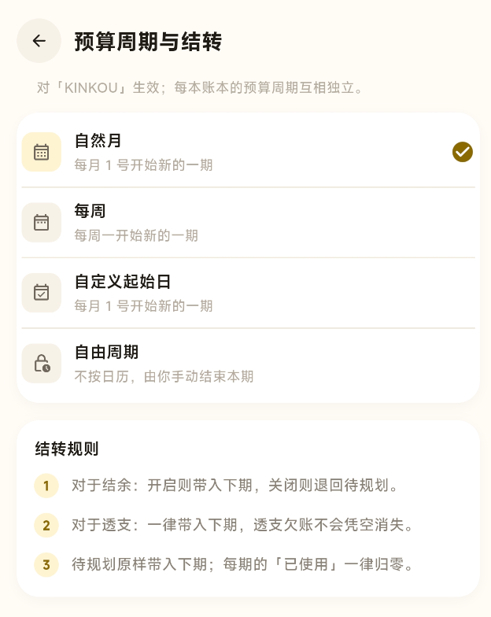

# 金打细算

基于“信封预算法”的本地存储记账应用

**使用Flutter开发**

  
&nbsp;
  
&nbsp;
  
&nbsp;
  

## 简介

「金打细算」是基于“信封预算法”的记账应用，轻量而简洁，其遵循的方法论大致为：拿到生活费或工资时，先将钱分进一个个「信封」，之后每笔花销从对应信封里扣，即**先分配、后消费**。

### 适用人群

* 高校生群体
* 社会劳动人士
* 感到市面上的记账软件功能臃肿，只想简单地以手头上的钱管理好当下消费的群体
* 有超支/月光困扰、需要事前规划约束的人，以及收入不规律者
* 已经知悉“信封预算法”方法且认可该方法的群体

### 功能特点

* ✉️ **信封预算法**：收入先进入「待规划」，再分配给各个信封；支持自定义规划周期，支持是否开启各个信封的跨周期结转
* ⌨️ **快速记账**：支出/收入/转移，拖拽操作、输入金额再点按确定，一气呵成
* 📊 **统计页**：展示按周/月/季等时间单位切换的收支趋势与信封占比
* 💾 **备份**：一键导出/导入 `.jx` 备份，另支持 CSV 导出
* 🙈 **金额隐私**：首页金额数字支持打码隐藏，避免向他人展示财力（？

### 与其他记账软件的差异

* 方法论差异：市面上主流的记账软件通常是先记支出，事后统计报表，预算只是软提醒且多为会员功能；而「金打细算」**先分配、后消费**，在保留了简单的流水记录功能的基础上，提供了预算主导的消费管理功能。
* 数据存储：纯本地、无账号、无云，主要是个人小项目折腾不起（
* 商业模式：完全免费

## 使用说明

什么是“信封预算法”？有关概念在【[摆脱超支困境，试试用这套「信封预算法」记账吧](https://sspai.com/post/61367)】已经讲得很详细，本项目的灵感来源也来自这篇文章，笔者建议读者去看看，没接触过信封预算法的人看了之后或许能感受到这种方法的魅力所在。下面笔者结合个人理解与「金打细算」的具体操作，给出简单使用说明：

### 让得到的每一块钱都做好「分工」

「金打细算」希望使用者可以将自己手头上已有的可支配的钱，以及后续得到的收入都先进入「待规划」，然后再将这些钱分配进各个信封，各类消费将由使用者决定使用哪个信封，然后从对应的信封内扣除金额。这样做的好处是，使用者只需专注于自己手头上已有的钱，且后续有新的收入时不容易干扰原来所做的预算。

* **记录收入**：点击首页顶部的「待规划」区域，输入金额数记录收入；

  

* **分配金额**：从「待规划」开始拖拽，将钱拖拽进信封，然后输入分配金额，完成分配；

  

* **记录消费**：从使用者想要消费的信封开始拖拽，将钱拖到底部，或双击对应信封，输入消费金额，记录支出。

  

### 设置信封的作用

「信封」这一容器概念大致对应于其他记账软件的各方账户（如微信钱包、支付宝、各大银行的储蓄卡等）——但其实很不一样，「金打细算」不提倡使用者细分各种账户的钱，这些钱应当全部一并视为手头可以支配的钱。信封的关键作用是做灵活预算，方便使用者厘清手头的钱发挥的作用，尽力避免在某些方面超支，以及避免使用者在临时调配时感到混乱。

使用者可以尝试给信封定下优先级，比如【当月刚需支出 > 时间不确定的重要支出 > 娱乐支出 > 存款】（根据个人需求设定信封，仅作参考）。

### 灵活调整预算

预算信封没有封口，可以随时调整。做预算很可能会出现对某项预算过于乐观的情况（比如冲动消费多花了一些钱），也可能会高估某项预算（比如划分了100给交通，实际上根本不出门）。莫慌，可以临时将预算从一个信封转到另一个信封，这样做的好处在于让使用者时刻注目预算，更清楚接下来的消费行为要做出什么改变。

信封是可透支的，即金额数可以小于0。若存在信封处于透支状态，软件会有醒目提醒，促使补上透支。

* **信封之间转移**：从一个信封开始拖拽，将钱拖到另一个信封，完成预算转移。  

  

### 预算周期与结转

**预算周期**：

预算周期是「金打细算」设定的分配有效时间区间，默认以每个自然月的 1 日开始新的周期，同时软件也提供让用户自定义每个月的起始日，也支持以周为一个周期（从周一开始），甚至支持自由周期——由用户手动结束当前周期。

在预算周期内，每个信封从「待规划」转入金额后，都将同时累加「已规划」，即这个信封在周期内从「待规划」进过多少钱，单击信封进入信封详情页可见。首页的信封上显示的进度条显示的进度为：`（当前周期的已规划 - 当前周期内信封的支出） / 当前周期的已规划`。

**结转**：

可以对每个信封单独设定是否结转至下一个周期。结转的意思是，当一个预算周期结束时，将信封里剩余的预算继承到下一个周期；若选择不结转，则对应的信封在预算周期结束时，剩余的预算将退回至「待规划」。

另外，若信封处于透支状态，则无论是否开启结转，透支状况都将延续至下一周期。

  

### 数据安全

* **隐藏首页显示的金额数目**：可对每个信封单独设定是否隐藏，进入信封详情页可设置；特别地，「待规划」的数目在「我的」页面设置是否隐藏。

* **用户数据**：软件不存在网络连接，其数据需要用户自主管理，开发者绝不会获取用户的数据。

## 下载安装

Android: [Releases(点这儿下载)](https://github.com/KINKOUsan/enve_keeper_app/releases/tag/v1.2.1)

## 关于本项目的开发
本项目大量使用AI进行编码，笔者只做了一些实机功能测试，如果发现项目有任何问题，或者有任何改进建议，都欢迎提Issues。笔者是个大学生，是个正在学习中的开发小白，有任何做得不成熟之处敬请谅解。

## 许可

尚未选择开源许可证，默认保留所有权利。
